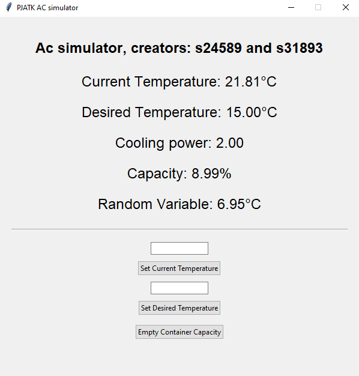

# Authors s24589 and s31893

To run this program install:
pip install tkinter
pip install skfuzzy
pip install numpy

then run main.py

---
# Description

This program simulates a working intelligent AC unit in a heated room. 
It uses 3 inputs: 
- desired temperature of the room, set by the user the program will attempt to cool the room as soon as possible until it reaches the desired temperature.
- the current temperature of the room
- capacity of its condensate water container

As the ac is running it gradually fills up with water as a byproduct of the dehumidification process. The higher the cooling power, the faster the container will fill up until the machine shuts down.
This program attempts to calculate optimal cooling power using fuzzy logic so that the room is cooled down as soon as possible
but also for as long as possible by reducing its power the closer its container is to filling up.

# Example image of running program

