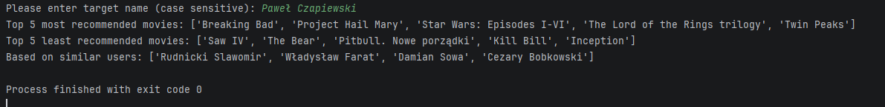
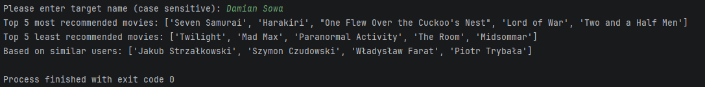
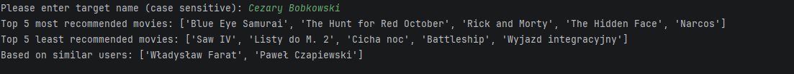

# Authors s24589 and s31893
This program uses the following dependencies: pandas, sklearn
Make sure to install them before running
---
How to  use
Run python main.py in console
You will be asked to enter a full name of the person you wish to run the algorithm for.
Please note that as data is copied  directly from [Lab's Spreadsheet](https://docs.google.com/spreadsheets/d/1OwX4iLz7jUfNSLC_UuRkS50ASYh5zrza4J11mzb9UU8/edit?usp=sharing) the input is case sensitive and must be entered exactly how it is there.
---

# Description

This app uses a kmeans clustering algorithm in order to recommend movies to a target user.
It first groups up users that rate same movies similarly then based  on their ratings tries to recommend a new movie to the target.

# concerns
This is a limited program as it only takes under consideration raw ratings of different movies. It does not consider any other attributes such as genre or  release date.
Due to limited data there is a possibility that some users will be assigned a lone cluster, resulting in no recommendation being made.
For the same reason the recommendations themselves may be weak, in order to mitigate it the program tries to only draw recommendations from top 5 most similar users to target. This removes weaker links but introduces bias.

# screenshots

